La GeekHouse (ギークハウス) est un concept OpenSource originellement inventé par [Pha](https://github.com/pha). Il s'agit d'une colocation dont le but est de rassembler des esprits créatifs ayant les mêmes centres d'intérêts.

Les Geek Houses sont indépendantes les unes des autres et sont gérées par des personnes différentes.

La Geek House Sud Paris est gérée par [n-studio](https://github.com/n-studio), un développeur web qui a vécu plusieurs années dans une Geek House au Japon.

Elle est située à Chevilly-Larue, tout près de Villejuif et Kremlin-Bicêtre, ce qui lui donne un emplacement idéal pour les étudiants d'EFREI, Epita, Epitech et Inalco.

Transports en commun :
* Bus 131, 186, 286, 192, 184 (à 2 min à pied)
* Métro 14 L'Hay-les-Roses (à 15 min en bus / 23 min à pied)
* Métro 7 Villejuif Louis Aragon (à 20 min en bus)
* Métro 7 Porte d'Italie (à 28 min en bus)
* RER B Bourg-la-Reine (à 18 min en bus)
* RER B Denfert-Rochereau (à 25 min en bus)

La Geek House Sud Paris ouvre ses portes en Mars 2020 et peut accueillir jusqu'à 4 résidents.

[Réservez votre chambre ou demandez plus d'info](/contact/)

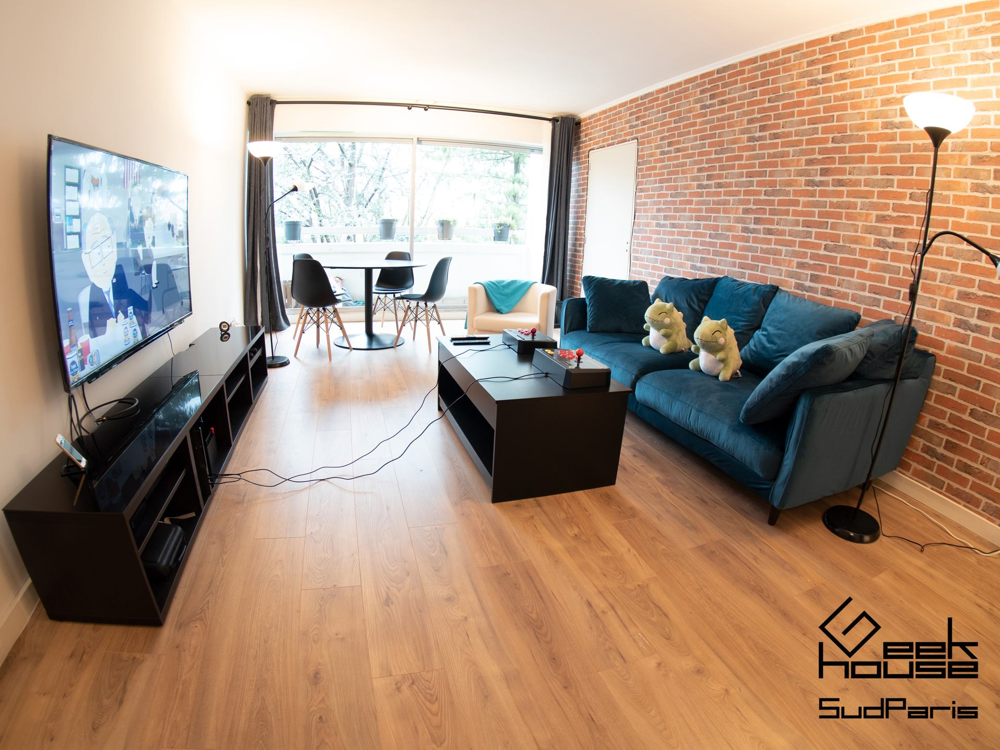{: loading="lazy"}
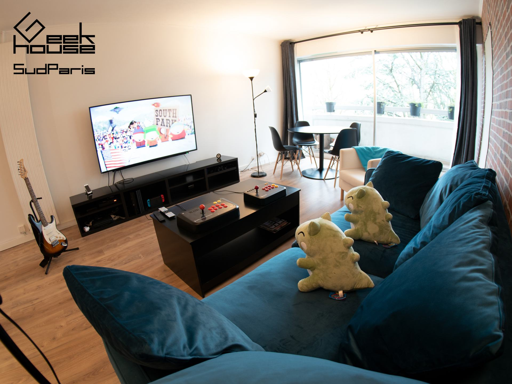{: loading="lazy"}
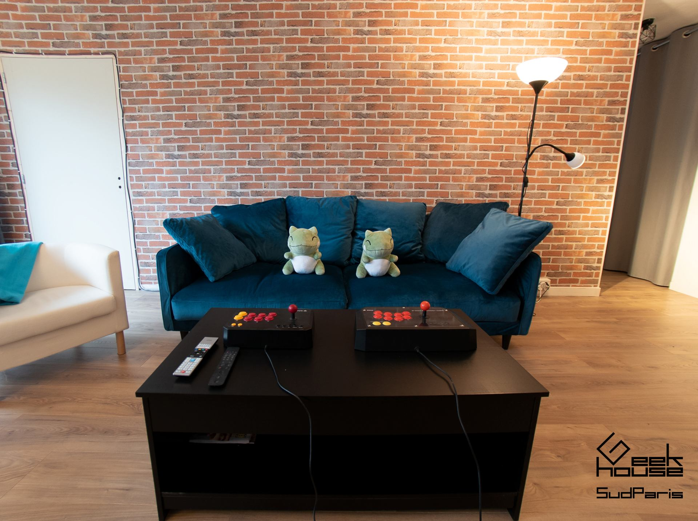{: loading="lazy"}
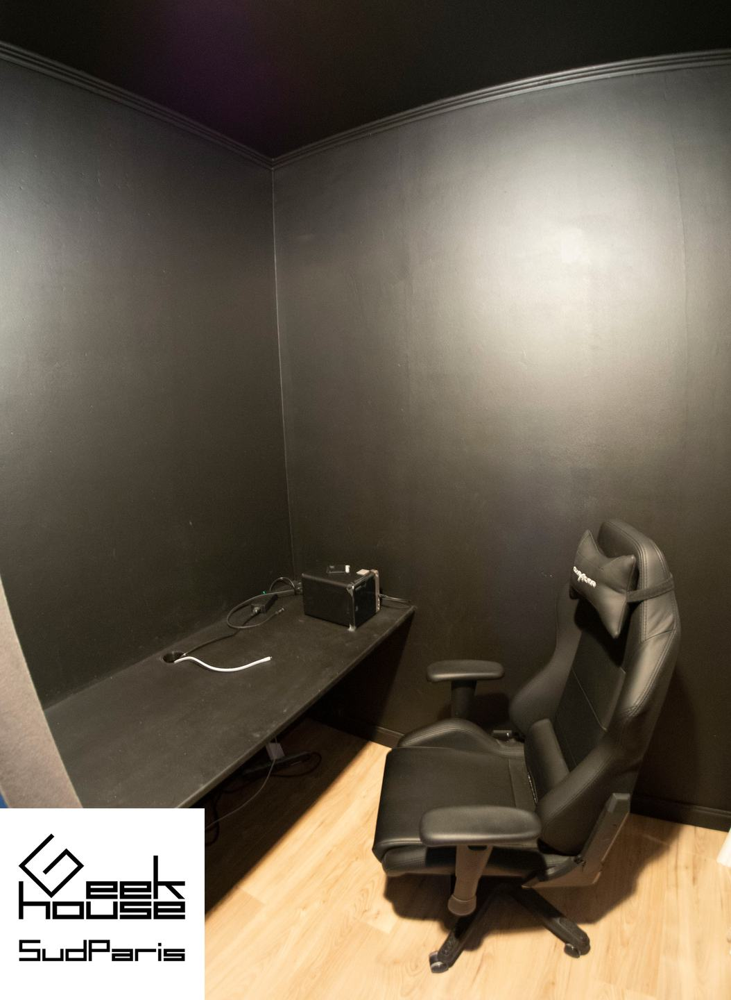{: loading="lazy"}
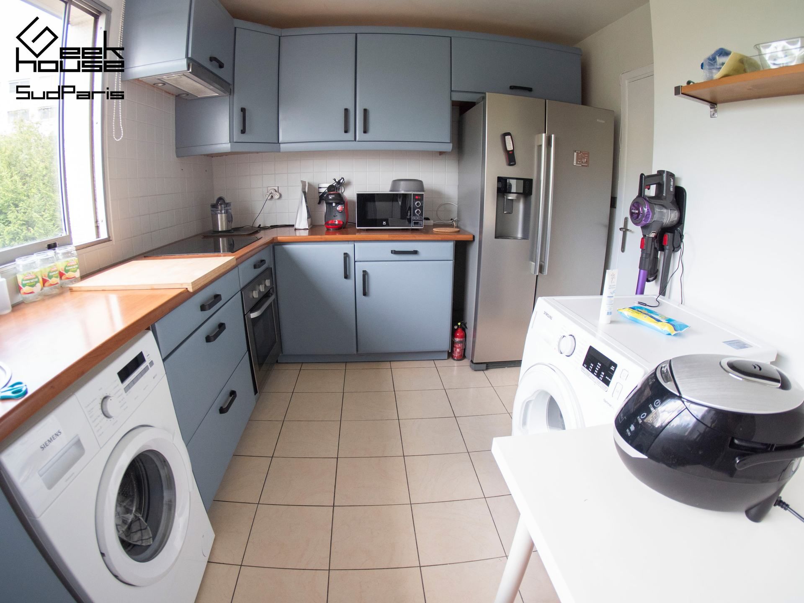{: loading="lazy"}
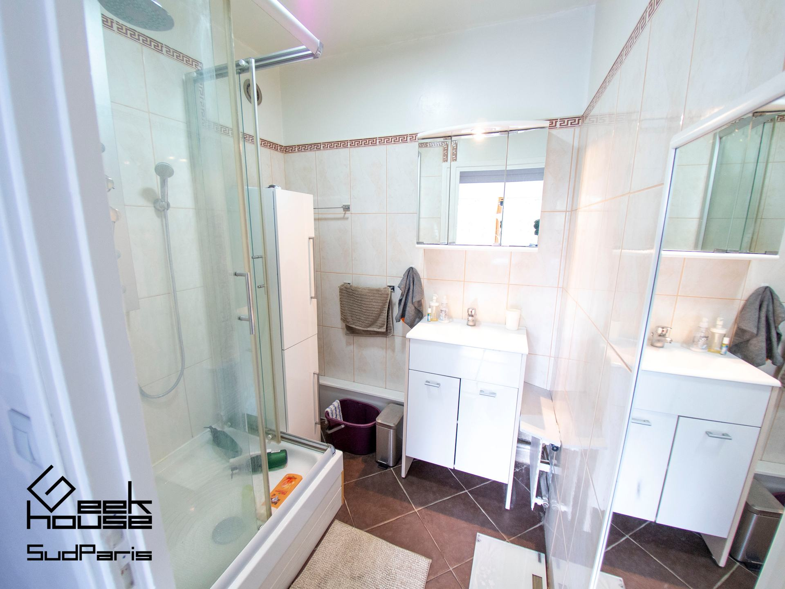{: loading="lazy"}
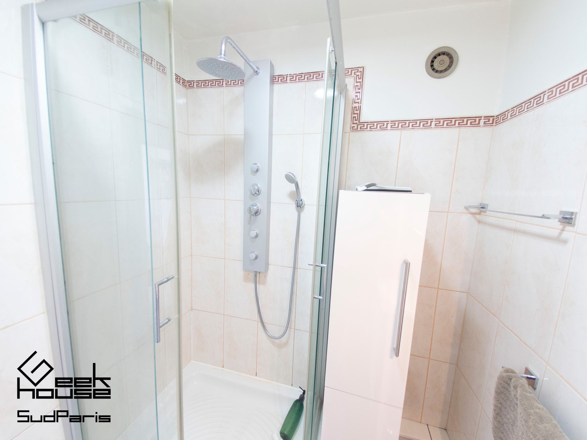{: loading="lazy"}
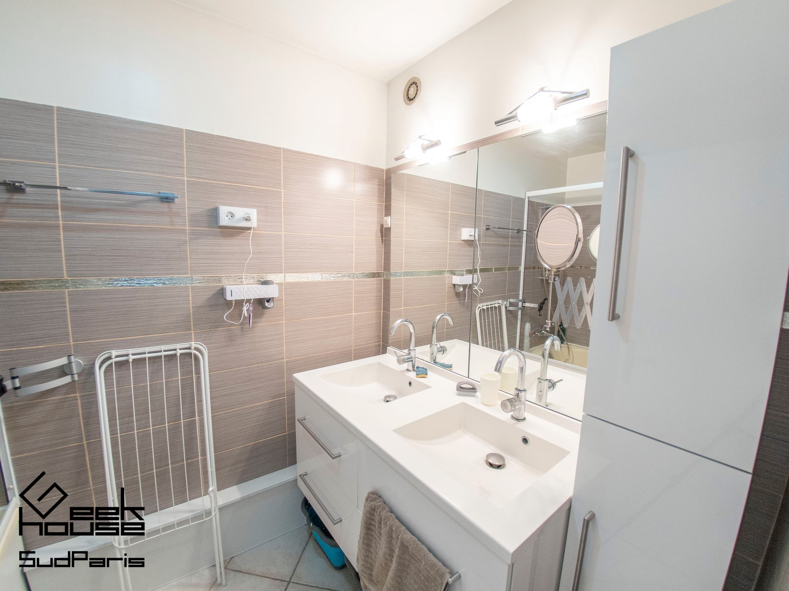{: loading="lazy"}
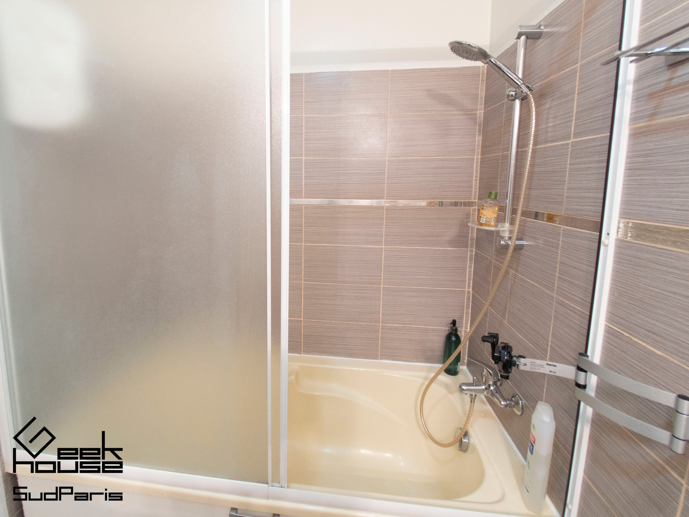{: loading="lazy"}
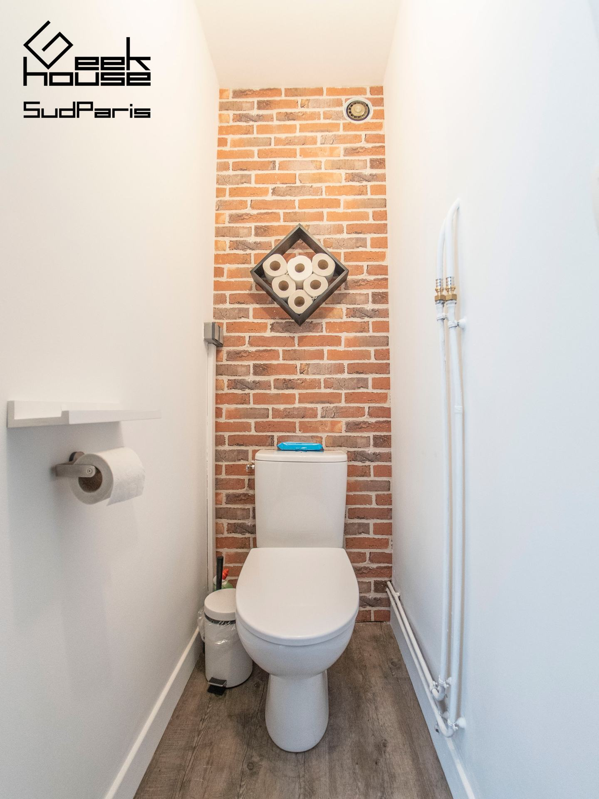{: loading="lazy"}
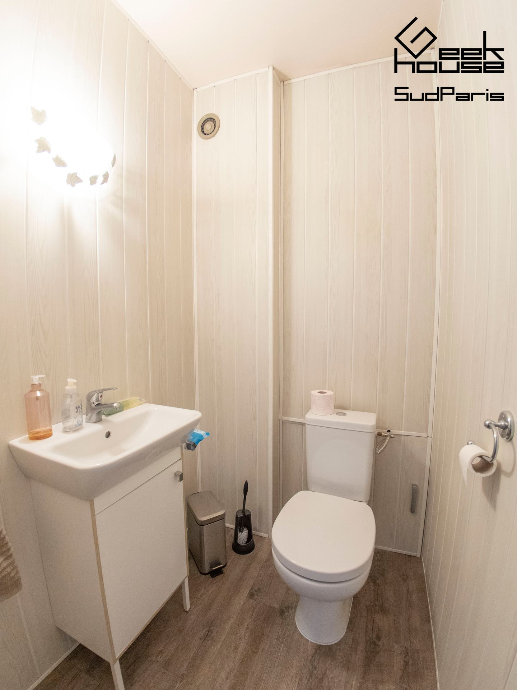{: loading="lazy"}

* [Geek House Project (wikipedia JA)](https://ja.wikipedia.org/wiki/ギークハウスプロジェクト)
* [Geek House Official List Webpage](https://geekhouse.github.io/rooms/)
